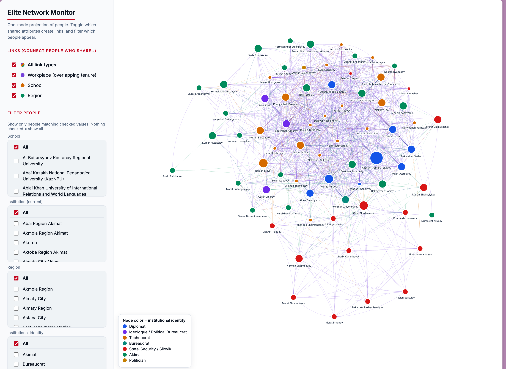

# Kazakh Elite Tracker

**Live demo: <https://erlan-bg.github.io/Kazakh-Elite-Tracker/>**

An interactive network map of 100 senior Kazakh officials (akims, ministers,
KNB and military leadership, presidential administration), linked by shared
careers, schools and home regions. Toggle link types, filter who appears, and
click any node for a sourced career history.

## Link types

Scholars of the region (Collins and Schatz on clan politics, Hale on patronal
politics) argue that power runs through informal networks. Each link type is
one hypothesized channel:

- **Workplace** — same institution, overlapping years. Same employer in
  disjoint eras does not link; embassies are separate from MFA headquarters.
- **School** — shared alma mater.
- **Region** — shared birth region.

Node color is **institutional identity** (diplomat, technocrat, political
ideologue, state security, military, akimat/regional). Anyone with no current
(`Present`) post is drawn faded and dashed as *out of government*.

## Data

100 people and 757 career positions across 215 institutions, 1986 to present.
Sources are official biographies (Akorda, ministry and akimat sites) and
public reporting.

## Limitations ⚠️

1. **Informal ties are invisible.** Family, marriage and business links,
   arguably the most important, are not in official bios. Co-tenure is a proxy
   for acquaintance, not proof of alliance.
2. **Selection.** The roster is the current senior cohort plus a few recently
   dismissed officials, not a random sample of the elite.
3. **Partial sourcing.** About half of positions carry a source URL, and
   official bios omit inconvenient episodes.
4. **Zhuz is a placeholder.** Only 3 of 100 people are coded so far.
5. **Year-level resolution.** Officials who overlapped by one month in the
   same year still link.

## Roadmap

- Time slider to replay the network year by year, before and after January 2022
- Zhuz coding for the full roster
- Source links for every position
